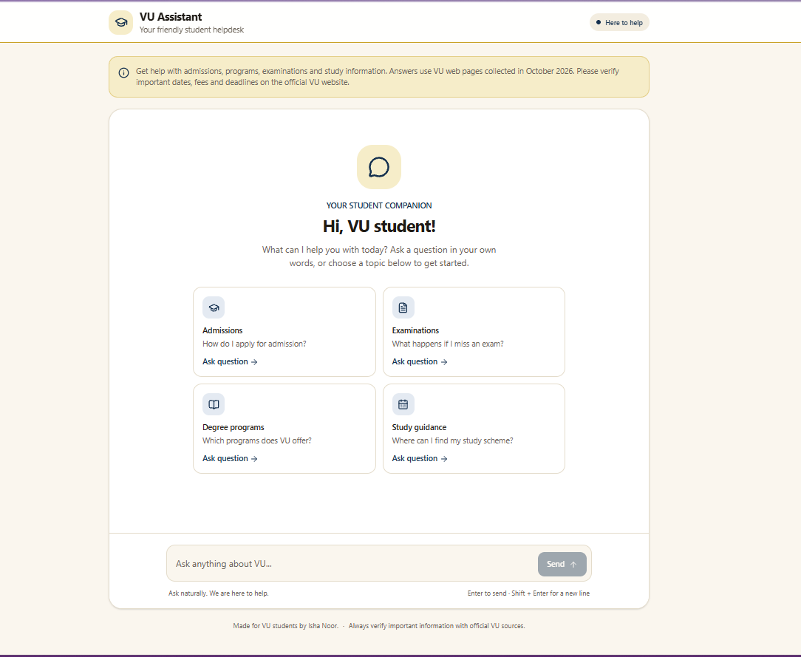

# VU Assistant

VU Assistant is a student helpdesk chatbot for Virtual University of Pakistan. It answers questions about admissions, degree programs, examinations, and study guidance using a collection of VU web pages and handbook documents.



## What it does

- Lets students ask questions in a chat interface and ask follow-up questions.
- Searches the project’s VU reference documents for relevant passages before generating an answer.
- Shows source pages with answers when available.
- Keeps answers focused on VU information and advises students to confirm important dates, fees, and rules with VU.
- Limits chat requests to 5 per minute and 40 per day per client IP to help protect the Gemini API quota.

## How answers are generated

The text files in `data/` contain reference material. `scripts/embed-docs.ts` splits those documents into chunks and creates embeddings with Gemini. When a student asks a question, `lib/retrieval.ts` embeds the question, finds the three closest chunks, and passes those passages to Gemini to prepare an answer. The chat endpoint is `app/api/chat/route.ts`.

The generated file `vector-store/chunks.json` is required for chat retrieval and is checked into this repository. Next.js is configured to include it in the `/api/chat` server bundle, so a deployment does not need to regenerate embeddings during every build.

## Requirements

- Node.js 20.9 or later
- npm
- A Gemini API key
- An Upstash Redis database for production rate limiting

## Run locally

Install dependencies and create your local environment file:

```bash
npm install
cp .env.example .env.local
```

Add your Gemini API key to `.env.local`:

```env
GEMINI_API_KEY=your-gemini-api-key
```

The checked-in vector store is ready to use. If you edit or recrawl the reference documents, regenerate the vector store:

```bash
npx tsx --env-file=.env.local scripts/embed-docs.ts
```

This step calls Gemini’s embedding API and may use your API quota. It replaces `vector-store/chunks.json`; review and commit the updated file along with the source changes.

Start the development server:

```bash
npm run dev
```

Open [http://localhost:3000](http://localhost:3000).

In development, rate limits use an in-memory counter. It resets when the server restarts and is only intended for local use.

## Production configuration

Set these variables in your hosting provider’s server-side environment settings:

| Variable | Purpose |
| --- | --- |
| `GEMINI_API_KEY` | Calls Gemini for question embeddings and answers. |
| `UPSTASH_REDIS_REST_URL` | Connects the production rate limiter to Upstash Redis. |
| `UPSTASH_REDIS_REST_TOKEN` | Authenticates the production rate limiter with Upstash Redis. |
| `CHAT_CLIENT_IP_HEADER` | Names the trusted proxy header containing the client IP. |

The proxy header must be set or overwritten by your hosting provider. For Vercel, set `CHAT_CLIENT_IP_HEADER=x-forwarded-for`. Do not use a header that visitors can set themselves. The production API fails closed with a temporary unavailable response if the Redis limiter or trusted IP header is not configured.

The repository includes `vector-store/chunks.json`, so the normal build command is sufficient:

```bash
npm run build
```

You do not need to provide `GEMINI_API_KEY` just to build the app. The key is required at runtime for chat requests and when you regenerate embeddings. The explicit Next.js file-tracing rule includes the vector store in the chat API deployment bundle.

## Refresh the VU reference material

The checked-in `.txt` files under `data/` are the chatbot’s source material. To crawl the configured VU pages again, install the Python packages and run:

```bash
python -m pip install requests beautifulsoup4 urllib3
python scripts/crawl_docs.py
npx tsx --env-file=.env.local scripts/embed-docs.ts
```

Review crawled text in `data/` before using it. Then generate a new vector store so the chatbot can search the updated material. VU pages, policies, fees, and deadlines can change; students should confirm time-sensitive details with VU.

## Useful commands

| Command | Purpose |
| --- | --- |
| `npm run dev` | Start the local development server. |
| `npm run build` | Build the Next.js app. The vector store must already exist. |
| `npm run start` | Start the production server after a build. |
| `npm run lint` | Run ESLint. |
| `npx tsx --env-file=.env.local scripts/search.ts "your question"` | Inspect the top retrieved passages for a question. |
| `npx tsx --env-file=.env.local scripts/ask.ts "your question"` | Run the retrieval and answer flow from the command line. |

## Project structure

```text
app/                  Chat interface and /api/chat endpoint
data/                 VU handbook and reference text files
images/               README and project images
lib/                  Gemini, retrieval, and rate-limit helpers
scripts/              Crawling, embedding, search, and CLI helpers
tests/                Chat questions and recorded evaluation notes
vector-store/         Generated embeddings used by chat retrieval
```

## Security and privacy notes

- Gemini and Upstash credentials are server-side secrets. Keep them in environment settings; do not commit `.env.local`.
- The API limits request bodies to 16 KiB, validates message and conversation-history structure, and sends no more than the latest 10 prior messages to Gemini.
- Production rate limits are shared through Upstash Redis. Local development uses a per-process in-memory limiter instead.
- The anonymous rate limit is based on client IP, not an authenticated account. People sharing an IP may share a quota, and IP-based limits do not replace authentication.

## Technology

Next.js App Router, React, TypeScript, Tailwind CSS, Google Gemini, and Upstash Redis.
